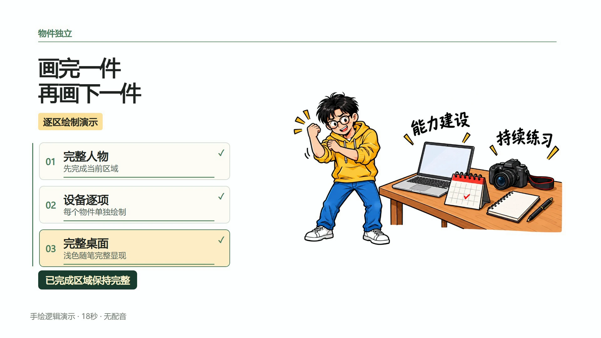
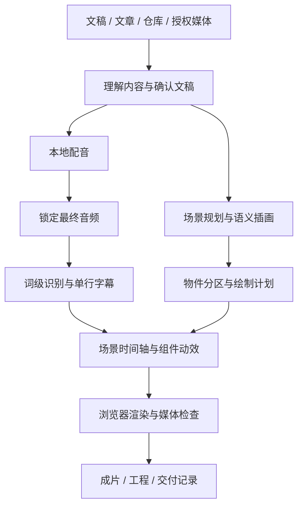

<div align="center">

# BoomEarth

### 让值得讲的内容，成为看得见的作品。

**面向自媒体、知识创作者与一人公司的开源视频生产工作流**

从文稿、声音到鲜彩漫画，把内容理解、素材制作、动态编排与交付检查连接起来。

`Agent 编排` · `鲜彩漫画` · `逐物件手绘` · `本地配音` · `真实时间字幕` · `可恢复工程`

[观看 Demo](#demo) · [核心能力](#capabilities) · [快速开始](#quick-start) · [技术架构](#architecture) · [文档导航](#documentation)

[](docs/assets/vivid-comic/2026-10/drawing-demo-18s.mp4)

**18 秒 · 1920 × 1080 · 30 fps · 两个完整场景**  
点击动图查看高清 MP4。本段为无配音绘制演示。

</div>

---

<a id="overview"></a>

## 01 · 项目定位

**BoomEarth 把一条视频背后的制作工作，组织成一套可以反复使用的工程。**

写出一篇好内容之后，还有很多工作：把书面表达整理成口播，为每一段选择画面，制作旁白，校准字幕，安排信息入场，再检查成片。一次修改可能牵动多个环节——稿件换了，配音需要更新；声音变了，字幕和场景也要重新对齐。

BoomEarth 用项目 Skills 组织这些专业步骤，用 Python 与 JavaScript 工具处理可确定的执行逻辑，并通过文件合同、时间轴和哈希记录素材之间的关系。创作者决定主题、观点和最终表达，Agent 负责协调制作，让每一次推进都落在具体的文件与可检查的结果上。

| 内容表达 | 视觉叙事 | 声音与节奏 | 工程复用 |
| :--- | :--- | :--- | :--- |
| 从来源与文稿出发，组织讲述重点。 | 让人物、动作和物件承担解释任务。 | 以最终旁白为基准，对齐字幕与画面。 | 保留素材绑定、阶段记录和交付证据。 |

项目采用本地优先的工作方式：本地保存工程、运行配音与渲染；来源采集、图像生成、语音识别等能力按具体路线接入。公开仓库提供代码、工作流入口、文档和选定的演示素材。

<a id="demo"></a>

## 02 · 鲜彩漫画作品展示

鲜彩漫画是本页展示的视觉主题：**干净的白底、清晰的黑色线稿、鲜明的色块，以及真正参与情境的人物。** 左侧承载讲述重点，右侧通过逐物件绘制推进画面；信息卡、手持画笔和场景切换共同形成观看节奏。

### 工作台：把“能力建设”画成具体行动



人物握拳、台历打勾，电脑、相机和笔记本构成一个具体的工作场景。画笔按物件顺序展开：先完成台历，再画它后方可见的电脑区域，随后推进其他设备与桌面。左侧信息卡同步强调当前讲到的内容。

### 阅读场景：让浅色区域也有完整的绘制过程


人物阅读、书堆与台灯、闹钟与生活物件共同表达“深度输入”和“守住时间”。笔筒、书堆、台灯、绿植分别绘制；闹钟、水果之后，浅色枕头与毯子随画笔完整显现。

| 演示信息 | 规格 |
| --- | --- |
| 内容 | 工作台、阅读与生活，两场各 9 秒 |
| 视频 | 18 秒，1920 × 1080，30 fps，H.264，无音轨 |
| 原生插画 | 每张 1672 × 941 |
| 截图 | 直接抽取同一 MP4 的实际帧，仅做 WebP 编码 |
| 本地工程 | [examples/vivid-comic](examples/vivid-comic/README.md) |
| 高清视频 | [drawing-demo-18s.mp4](docs/assets/vivid-comic/2026-10/drawing-demo-18s.mp4) |
| 规格与哈希 | [演示素材记录](docs/assets/vivid-comic/2026-10/manifest.json) |

这段 Demo 集中展示绘制与编排效果。有声视频的配音、最终音频识别和字幕流程，见下文的制作流程与部署说明。

<a id="use-cases"></a>

## 03 · 谁可以用它，具体能做什么

| 使用者 | 可以带入的内容 | 可以组织成的作品 | 能分担的制作工作 |
| --- | --- | --- | --- |
| **自媒体创作者** | 已写好的文章、观点、工具体验 | 有旁白、有插画、有信息重点的讲解视频 | 口播整理、场景规划、配图、字幕对齐与动效合成 |
| **OPC / 一人公司** | 产品介绍、服务方法、客户常见问题 | 产品解读、使用说明、方法分享 | 将一份内容沿同一工程推进，减少反复搬运稿件、音频与图片 |
| **知识与教育创作者** | 概念讲解、学习笔记、步骤说明 | 以人物动作和物件关系解释知识的漫画视频 | 把抽象段落拆成可视场景，安排文字、画面和讲述顺序 |
| **开源项目作者** | GitHub 仓库、功能说明、技术文稿 | 面向普通使用者的项目介绍视频 | 来源整理、功能与使用场景提炼、视觉化表达 |
| **内容团队与开发者** | 已有选题流程、素材规范、审核要求 | 可继续扩展的视频工作流 | 复用合同、编译、渲染、恢复与检查模块 |

对一个人来说，最有价值的变化是：**写作者、配音制作、插画编排、字幕整理和视频检查，可以围绕同一个项目协作。** 你仍然掌握内容判断与审美选择，重复的文件整理、时间对齐和规则检查交给工具处理。

例如，把一篇“AI 如何帮助个人工作”的文章做成视频，可以依次形成：一份确认过的口播稿、若干语义场景、人物与工作物件的完整插画、锁定的旁白、与声音对齐的单行字幕，以及可预览和渲染的工程。后续修改也能根据这些绑定关系定位受影响的阶段。

<a id="capabilities"></a>

## 04 · 核心能力

### 内容理解与制作编排

| 能力 | 具体处理什么 | 留下什么 |
| --- | --- | --- |
| **多种内容入口** | 按路线处理现成文稿、授权文章、GitHub 项目、视频或音频；视频输入按需增加下载与来源转写 | 来源证据、私有工作项或直接文稿输入 |
| **文稿确认与绑定** | 组织讲述重点，保存批准全文；把内容版本交给后续配音和制作步骤 | 交接稿、内容计划、版本与哈希 |
| **按语义拆分场景** | 确定每场核心意思、人物动作、物件关系、标题与少量原生文字 | 场景计划、插画提示词与素材清单 |
| **阶段接续** | 根据 production note、真实产物与校验结果识别完成位置 | 接手状态、下一步和失败记录 |

### 声音、画面与时间轴

| 能力 | 具体处理什么 | 观看体验 |
| --- | --- | --- |
| **本地 IndexTTS2 配音** | 接入独立模型环境和授权参考声音，按项目流程合成并校验旁白 | 声音可按自己的内容与音色准备 |
| **最终音频词级字幕** | 对锁定旁白做语音识别，保留真实词时间，再组织字幕显示 | 单行字幕跟随实际讲述，重点词句可局部强调 |
| **完整语义插画** | 人物参与动作，道具表达关系，短文字作为画面的一部分 | 每一场画面对应一个讲述重点 |
| **逐物件手绘** | 使用像素归属与绘制顺序，分别呈现人物、道具、浅色和文字 | 画完当前物件，再进入下一项 |
| **内容驱动动效** | 使用场景、字幕与组件 cue 编排标题、信息卡、画笔和切换 | 讲到哪里，重点就推进到哪里 |
| **本地合成与检查** | 通过浏览器时间轴渲染，检查画面、字幕、媒体规格和交付文件 | 输出可播放的成片及对应工程记录 |

### 可维护的生产工程

素材清单绑定原图与提示词，字幕绑定最终声音，渲染工程保存所使用的输入快照。检查发现问题后，可以追到具体素材或阶段。已经通过验证的资产可以按合同复用；更新输入时重新核对依赖，避免把不同版本混在一起。

<a id="drawing"></a>

## 05 · 逐物件手绘如何工作

**手绘的关键，是画笔、物件与像素之间有明确的对应关系。**

鲜彩漫画主题使用两份互相配合的输入：`sponge-drawing-plan.json` 描述物件顺序和权重，`comic-semantic-parts.json` 绑定原图、尺寸及逐像素语义归属。正式漫画工程缺少绘制计划、缺少分区或绑定失效时，编译会停止。

| 设计 | 实现方式 | 解决的问题 |
| --- | --- | --- |
| **每个物件有独立分区** | 为人物、相机、台灯、书本等分配独立归属；文字仅占真实笔迹 | 相邻物件轮廓相接时，也能按顺序分别显现 |
| **遮挡关系进入绘制顺序** | 先画前景物件，再补其后方的可见表面 | 完成的电脑或枕头上不会预留另一个物件形状的空洞 |
| **浅色随笔呈现** | 在白底合成源像素，笔刷首次触及便显示原色，并覆盖同物件相邻浅色碎片 | 屏幕、白鞋、淡色阴影与枕头能参与实际绘制 |
| **完成区域保持稳定** | 已显现像素不被后续笔画改写 | 画下一件时，前面完成的人物与道具保持完整 |
| **末帧不叠整图补洞** | 绘制过程完成像素覆盖，结束时保持同一结果 | 减少最后一刻突然补色、跳图的观感 |
| **时间轴可回退复现** | 按时间重建对应绘制状态 | 预览、跳转和检查使用一致的时间逻辑 |

语义分区需要针对每张插画准备并检查。新插画有新的轮廓、遮挡和文字位置，示例的遮罩坐标不能直接套用。工程检查能验证像素归属和显示过程，物件拆分是否符合人的理解仍需看图确认。

### 已公开的验证结果

以下结果对应上方的两场 18 秒 Demo，范围与文件哈希均记录在[演示素材记录](docs/assets/vivid-comic/2026-10/manifest.json)中。

| 验证项 | 结果 |
| --- | ---: |
| 语义分区 | 24 个 |
| 过程检查点 | 216 个 |
| 未分配的可见像素 | 0 |
| 后续分区提前显现 | 0 |
| 已完成像素被改变 | 0 |
| 末帧补色像素 | 0 |
| 回退后重放一致性 | 通过 |
| MP4 解码帧数 | 540 帧 |
| 实际 MP4 画面抽查 | 69 帧 |

这些是本段绘制演示的检查结果。完整有声视频还需要旁白、字幕、音画与正式交付检查。实现说明见 [鲜彩漫画逐区绘制](docs/comic-semantic-drawing.md)。

<a id="workflow"></a>

## 06 · 从内容到作品的制作流程



| 阶段 | 核心工作 | 进入下一阶段的依据 |
| --- | --- | --- |
| **1. 输入与理解** | 确认内容目标，按输入类型选择来源路线 | 有效文稿或来源证据 |
| **2. 文稿定稿** | 整理口播、确认全文，建立内容计划 | 批准版本及其绑定信息 |
| **3. 制作素材** | 准备配音与逐场景插画；可独立推进的工作按合同并行 | 旁白、插画和对应素材记录 |
| **4. 锁定时间** | 使用最终音频做词级识别，形成字幕与场景时间 | 音频哈希、字幕文件、时间线 |
| **5. 编排画面** | 安排信息卡、原生文字、物件绘制与场景切换 | 运动计划、语义分区、可预览工程 |
| **6. 渲染检查** | 合成视频，检查过程帧、字幕、媒体与交付一致性 | 检查结果及实际 MP4 |
| **7. 归档接续** | 保存交付记录与工程状态，为下次修订保留依据 | 成片、清单、检查报告与接手状态 |

最终旁白是时间基准。确认声音之后再确定词时间、字幕与相关 cue；文稿或音频发生变化时，重新核对依赖它的时间线。

<a id="architecture"></a>

## 07 · 技术架构

BoomEarth 将内容判断与可确定的执行步骤分层组织。Agent 阅读项目状态、协调阶段；专业 Skills 描述输入与交付要求；程序负责校验、编译、渲染及恢复操作。

| 层次 | 职责 | 主要入口 |
| --- | --- | --- |
| **工作流编排** | 识别输入路线、接手续作、组织阶段交付 | [总入口 Skill](.agents/skills/ra-source-to-video/SKILL.md)、[制作导演](.agents/skills/katerj-video-director/SKILL.md) |
| **专业制作步骤** | 约束来源、配音、插画、字幕、动效等各自的输入输出 | [.agents/skills](.agents/skills) |
| **合同与执行逻辑** | 验证内容计划、素材、声音和时间线；组织采集、编译与交付 | [src/boomearth](src/boomearth)、[automation/scripts](automation/scripts) |
| **画面运行时** | 通过 HTML、Canvas 与 GSAP 呈现场景及绘制过程，由 HyperFrames 输出视频 | [video-content-template](video-content-template)、[漫画示例](examples/vivid-comic) |
| **证据与检查** | 通过快照、SHA-256、阶段记录、回归测试与媒体检查核对结果 | [tests](tests)、[交付检查入口](automation/scripts/check_delivery.py) |

### 技术栈

| 组件 | 用途 |
| --- | --- |
| **Python 3.11 / uv** | 项目合同、来源处理、素材校验、时间线与生产脚本 |
| **Node.js 22.12+ / npm** | 示例准备、浏览器检查及前端渲染工具 |
| **GSAP 3.15.0** | 可定位到具体时间的场景与组件动画 |
| **HyperFrames 0.7.106** | HTML 工程预览、检查与视频渲染 |
| **HTML / Canvas / JavaScript** | 版式、手持画笔、物件绘制与字幕呈现 |
| **FFmpeg / ffprobe** | 音视频处理、规格读取与解码检查 |
| **IndexTTS2** | 独立接入的本地旁白合成环境 |
| **ImageGen / 最终音频 ASR** | 按生产路线接入的图像生成和词级识别能力 |

### 关键工程文件

| 文件 | 记录什么 |
| --- | --- |
| `content-plan.json` | 内容结构、场景及所选视觉主题 |
| `scene-timeline.json` | 场景与最终声音的时间关系 |
| `motion-plan.json` | 场景及组件的运动安排 |
| `illustration-manifest.json` | 插画、提示词、候选和质量检查的绑定 |
| `sponge-drawing-plan.json` | 组件绘制顺序与权重 |
| `comic-semantic-parts.json` | 漫画原图哈希、尺寸与像素归属 |
| `voice_manifest.json` | 旁白音频的相关记录 |
| `publication-manifest.json` | 正式生产交付的文件绑定 |

这是按路线使用的文件集合：无配音的公开 Demo 只包含演示需要的部分；制作完整有声视频时再建立对应声音、字幕与交付合同。

<a id="quick-start"></a>

## 08 · 快速开始

### A. 先在本地打开鲜彩漫画 Demo

示例已包含两张插画、分区数据和 18 秒时间轴。预览这段工程只需准备 Git、Node.js **22.12+** 与 npm；进行视频渲染和过程检查时，还需工具可用的 Chrome / Chromium 和媒体环境。

```powershell
git clone https://github.com/kaiteJiang/BoomEarth.git
cd BoomEarth
npm ci

node automation/scripts/prepare_vivid_comic_demo.mjs
npx hyperframes preview examples/vivid-comic
```

准备脚本从已安装的 GSAP 与仓库运行时生成资源，检查本地引用及原图绑定。相同内容直接复用；生成资源变化时，旧字节保存在 `generated/retained/`。

**这条演示路线不需要配音模型、图像生成或 ASR 密钥。** 可先体验画面与时间轴，再决定是否接入完整制作环境。

渲染示例：

```powershell
npx hyperframes render examples/vivid-comic --output examples/vivid-comic/renders/demo.mp4
```

详细输入与检查命令见 [示例工程 README](examples/vivid-comic/README.md)。

### B. 准备完整视频制作环境

完成 A 中的仓库克隆与 `npm ci` 后，在仓库根目录继续以下步骤。

当前主要实测环境为 Windows。完整制作还需要 Python **3.11**、uv、FFmpeg / ffprobe，以及能读写项目、执行命令并调用所需模型能力的 Agent 环境。

```powershell
uv python install 3.11
uv sync --dev
uv run pytest tests/test_config.py -q
npm run hf:doctor
```

| 能力 | 需要额外准备的内容 |
| --- | --- |
| 本地旁白 | IndexTTS2 环境、兼容权重、有效模型路径与授权声音参考 |
| 场景插画 | Agent 可调用的图像生成能力及对应额度 |
| 最终音频字幕 | 当前流程采用的火山 / 豆包词级识别配置与用量 |
| 来源视频处理 | 仅该路线需要的下载与来源转写能力 |
| 中文排版 | 本机可用且符合工程要求的字体 |

仓库依赖安装负责代码与工具；模型权重、声音参考和外部服务需分别配置。按 [部署与使用指南](docs/DEPLOYMENT-AND-USAGE.md)完成接入后，先用一条短片验证声音、画面、字幕和合成，再增加时长与场景数量。

<a id="usage"></a>

## 09 · 怎样发起一次制作

在 Agent 中打开本项目，让它读取根 `AGENTS.md`，再通过总入口与制作导演组织工作。下面的描述可以作为任务起点。

### 用自己的文章制作视频

> 请按 BoomEarth 流程，把下面的文章制作成约 60 秒横版讲解视频。先整理口播稿供我审阅。视觉使用鲜彩漫画逐项绘制主题 `vivid-comic-component-brush-v1`，保留左文右图、信息卡和手持画笔。人物、物件与文字分别分区，浅色随笔显现。定稿后按工程合同推进配音、字幕、渲染与检查。文章：……

### 用已定稿文案开始制作

> 下面是已确认的全文，请保留原文，使用鲜彩漫画逐项绘制风格制作。先检查当前模型与媒体环境，然后建立场景、声音、字幕和素材绑定。优先展示一段有代表性的短样片，再按确认范围完成。文稿：……

### 接着已有项目继续

> 继续这个项目：`<项目路径>`。先检查 production note、交接稿、已完成文件和哈希，从第一个未完成阶段续做。复用仍然有效的配音、字幕与插画，并说明本次实际更新了哪些产物。

本页示例显式选择鲜彩漫画主题。仓库现有默认主题仍为 `sponge-host-handdrawn-v1`；历史工程保持各自绑定的主题与合同。

<a id="engineering"></a>

## 10 · 质量、恢复与扩展

### 质量检查覆盖制作过程

| 检查对象 | 关注的问题 |
| --- | --- |
| 内容与声音 | 配音是否对应确认全文，当前声音是否仍是锁定版本 |
| 字幕与时间 | 字幕是否来自最终音频，显示是否单行且没有时间重叠 |
| 插画与语义 | 人物动作、物件关系、原生文字是否与内容一致 |
| 手绘过程 | 是否独立分区、是否漏白、是否提前露出后续物件、完成画面是否稳定 |
| 实际视频 | 能否完整解码，入场、中途与完成帧是否正确 |
| 交付一致性 | 成片、工程、清单与哈希是否对应同一版本 |

像素检查与媒体检查帮助定位技术问题，创作者仍通过试听和看片判断表达、节奏与观感。两类结果共同服务于最终确认。

### 中断之后，按已有证据继续

接手时先查项目状态与真实文件，再决定需要执行的阶段。批准稿、旁白、插画与字幕有效时可以复用；输入发生变化时，核对相关哈希与后续依赖。来源恢复、已完成服务结果取回、已渲染项目的归档续接，各自使用对应脚本与合同。

完整生产的 `finalize` 入口用于已有项目的收尾，需要齐全的素材与批准旁白等输入。具体前置条件见[连续制作编排](docs/VIDEO-CONTINUOUS-ORCHESTRATION.md)。

### 为自己的流程扩展

可以从三类边界开始：在主题注册和插画合同中增加画风，在独立 Provider 中接入来源或模型能力，或在画面运行时中增加经过验证的组件动作。改动应同时考虑输入合同、现有工程兼容性和实际媒体输出。

<details>
<summary><strong>展开：目录结构与开发入口</strong></summary>

```text
BoomEarth/
├── .agents/skills/            # 编排入口与专业制作步骤
├── src/boomearth/
│   ├── workbench/            # 来源、交接、项目状态与归档
│   ├── providers/            # 外部来源与识别服务适配
│   ├── audio/                # 本地 IndexTTS2
│   ├── captions/             # 字幕对齐、显示与检查
│   ├── media/                # 来源媒体处理
│   └── video/                # 内容、插画、动效与渲染合同
├── automation/scripts/       # 生产与检查 CLI
├── video-content-template/   # HTML 模板与画面运行时
├── examples/vivid-comic/     # 可本地体验的 18 秒漫画工程
├── docs/                     # 部署、流程、原理与公开素材
└── tests/                    # 回归检查
```

查看生产入口参数：

```powershell
uv run python automation/scripts/compile_content_plan.py --help
uv run python automation/scripts/run_content_production.py finalize --help
uv run python automation/scripts/check_delivery.py --help
```

对漫画绘制相关修改，可运行针对性检查：

```powershell
uv run pytest tests/test_comic_semantic_parts.py tests/test_sponge_components.py tests/test_content_render_project.py -q
node --test tests/vivid-comic-pixel-ownership.test.mjs tests/prepare-vivid-comic-demo.test.mjs
```

浏览器像素检查默认寻找 Windows 标准安装位置的 Chrome；其他路径通过 `CHROME_PATH` 指定。新增外部能力的离线测试应保持可在无真实服务调用的条件下运行。

</details>

<a id="faq"></a>

## 11 · 常见问题

<details>
<summary><strong>只想试试效果，需要先安装所有模型吗？</strong></summary>

不需要。先按快速开始 A 运行已有漫画工程，它使用仓库内的插画与分区数据。制作自己的有声视频时，再按路线接入配音、图像生成与最终音频识别。

</details>

<details>
<summary><strong>它是一个直接粘贴文案就自动出片的网页产品吗？</strong></summary>

目前提供的是面向 Agent 与本地环境的视频生产工作流，包括 Skills、代码、脚本、合同和示例工程。常规制作由 Agent 按项目规则协调，内容审阅、素材判断和外部能力配置属于实际流程的一部分。

</details>

<details>
<summary><strong>鲜彩漫画里的分区可以自动套用到其他图片吗？</strong></summary>

新图需要自己的语义归属。相机带、台灯光线、人物衣服、手写文字可能相接或遮挡，单纯按矩形或连通块切开不足以判断物件。已有示例可用于理解输入格式与观看效果，实际新图仍需准备并复核分区。

</details>

<details>
<summary><strong>可以使用自己的声音吗？</strong></summary>

可以按本地配音流程接入自己的授权参考录音、模型环境与音色记录。参考音频需要完成质量检查、注册及来源记录绑定。仓库不附带作者私人声音；配置方式见部署指南与本地配音 Skill。

</details>

<details>
<summary><strong>本地运行还会产生哪些费用？</strong></summary>

按使用路线，成本可能包含本地计算、Agent 订阅或用量、图像生成和语音识别。现成文稿可以省去来源采集与来源转写；公开 Demo 已有完整素材。实际费用取决于时长、场景数量、模型与重试情况，仓库没有统一的单条视频报价。

</details>

<details>
<summary><strong>为什么字幕必须以最终声音为准？</strong></summary>

停顿、语速、重读与读音会影响每个词的位置。最终旁白确定后获取真实词时间，字幕与画面才能跟随实际讲述。替换声音或修改稿件后，需要重新核对相关时间线。

</details>

<details>
<summary><strong>是否必须使用鲜彩漫画或数字人？</strong></summary>

主题由具体项目绑定。仓库保留海绵等注册主题，本页重点展示鲜彩漫画；当前常用插画路线不依赖数字人，HeyGen 属于明确启用后才进入的可选分支。

</details>

<a id="documentation"></a>

## 12 · 文档与参与

### 按目标选择入口

| 目标 | 文档 |
| --- | --- |
| 查看、运行这段鲜彩漫画 Demo | [示例工程](examples/vivid-comic/README.md) |
| 理解语义分区与逐物件绘制 | [绘制原理](docs/comic-semantic-drawing.md) |
| 安装完整生产环境 | [部署与使用指南](docs/DEPLOYMENT-AND-USAGE.md) |
| 开始新视频或接手已有项目 | [制作 Runbook](docs/VIDEO-PRODUCTION-RUNBOOK.md) |
| 理解任务接续与阶段交付 | [连续制作编排](docs/VIDEO-CONTINUOUS-ORCHESTRATION.md) |
| 为 Agent 找到总入口 | [来源到成片 Skill](.agents/skills/ra-source-to-video/SKILL.md) |
| 查看早期样片与架构演进 | [海绵全场景样片](docs/sponge-fullscene-sample.md) · [项目历史](docs/PROJECT-HISTORY.md) |
| 核对演示文件规格 | [Demo 清单与 SHA-256](docs/assets/vivid-comic/2026-10/manifest.json) |

### 反馈与贡献

欢迎围绕可复现的问题、主题扩展、绘制质量、文档与环境兼容性改进项目。提交问题时，提供系统与运行版本、执行命令、预期和实际表现；绘制问题附上能够说明阶段的截图或短片。修改实现时，保留相应输入合同，并附上与改动相关的检查结果。

[提交 Issue](https://github.com/kaiteJiang/BoomEarth/issues) · [查看 Pull Requests](https://github.com/kaiteJiang/BoomEarth/pulls)

### 开源范围与许可

原创代码、测试、文档及项目自有工作流入口按 [MIT LICENSE](LICENSE) 中的范围开放。仓库保留的第三方组件、脚本、字体与素材遵循各自许可，其中部分历史组件为 CC BY-NC 4.0；具体范围与来源见 [LICENSE-NOTES.md](LICENSE-NOTES.md)。

公开演示素材与私有生产资料分开管理。个人声音、来源媒体、服务凭据和完整私有生产工程保留在本地。

---

<div align="center">

**把精力留给值得表达的内容，把制作沉淀为可以复用的能力。**

[观看 Demo](#demo) · [运行示例](#quick-start) · [阅读制作指南](docs/VIDEO-PRODUCTION-RUNBOOK.md)

</div>
